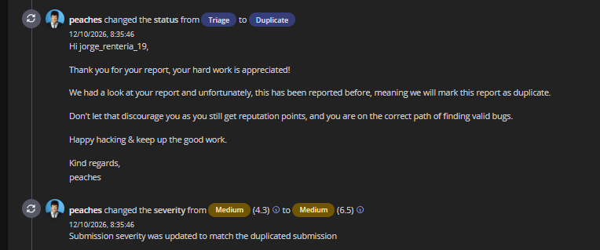

# Netafim GrowSphere — Broken Access Control in Farm User Management

> **Status:** Duplicate
>
> **Severity:** Medium (6.5), updated from Medium (4.3) during triage
>
> **Asset:** `*.netafim.com` (wildcard)
>
> **Bounty:** No bounty
>
> **Category:** Broken Access Control / Broken Object-Level Authorization (BOLA / IDOR)

## Summary

The user update API allowed requests authenticated with a different user's token to modify a target user's first name, last name, and phone number.

The report concerns the farm user management page. Testing used controlled accounts and harmless test data. Requests returned **HTTP 200 OK**, and the modified profile fields persisted.

Attempts to modify the target user's **role** or **email address** were not successful. **No privilege escalation was demonstrated.**

## Affected component

- Application page: `https://growsphere.netafim.com/home/farm/users`
- API endpoint: `PUT https://csapi.k8s.growsphere.netafim.com/api/v1/users/{userId}`

## Proof of concept

1. Sign in with a controlled test account with limited privileges.
2. Identify a second controlled test account that the first account is not authorized to manage.
3. Capture a legitimate request to the user management API.
4. Send a `PUT /api/v1/users/{targetUserId}` request using the limited-privilege account's authenticated session.
5. Modify a harmless profile field such as `firstName`, `lastName`, or `phoneNumber`, using test data.
6. Submit the request.
7. Refresh or reopen the target profile to confirm whether the change persisted.

## Actual result

The API returned **HTTP 200 OK** and allowed the tested profile fields to be modified using another user's token.

Changes to the target user's role and email address did not succeed during testing.

## Expected result

The server should verify that the authenticated caller is authorized to manage the specific target user and to modify each submitted field. A valid authentication token alone must not authorize cross-account changes. Unauthorized requests should be rejected without modifying the target profile.

## Security impact and limits

If accounts that should be isolated can perform these updates, a limited-privilege user could cause unauthorized changes, confusion, or integrity issues in other users' profile records.

The demonstrated impact is limited to first name, last name, and phone number. The report does not demonstrate privilege escalation, account takeover, role modification, or email modification.

## Recommended remediation

- Enforce server-side authorization for every user update.
- Verify that the requesting account may manage the specific target user.
- Allowlist editable fields according to the caller's role and permissions.
- Reject unauthorized changes even when a valid authentication token is supplied.
- Add regression tests for cross-account updates and field-level permissions.

## Triage outcome

On **12 October 2026**, the status changed from **Triage** to **Duplicate** because the issue had already been reported. The severity changed from **Medium (4.3)** to **Medium (6.5)** to match the previously reported submission.

The supplied screenshot does not establish a submission date, remediation status, or bounty payment.

## Relationship to the other Netafim report

This is a separate submission concerning the **farm user management** page. The [other Netafim report](../netafim-growsphere-profile-update-idor/) concerns the **my-account** page. Both describe profile updates through the same API route.

These are documented as **two duplicate submissions**, not as two independently established root causes.

## Evidence handling

The public report includes the supplied triage screenshot. Authentication tokens, actual account identifiers, personal profile data, and private HTTP captures are omitted.

## Development lessons

Authentication and authorization are separate checks. User management APIs need object-level permissions and field-level restrictions, supported by tests for both authorized and unauthorized operations.
