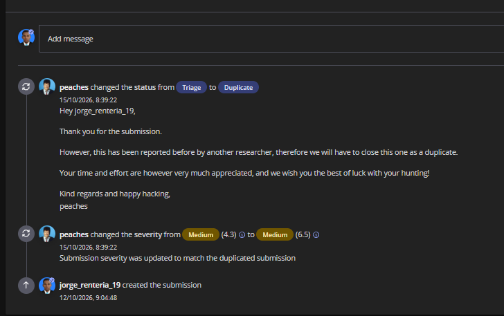

# Netafim GrowSphere — Broken Object-Level Authorization in Profile Updates

> **Status:** Duplicate  
> **Severity:** Medium (6.5), updated from Medium (4.3) during triage  
> **Asset:** `*.netafim.com` (wildcard)  
> **Bounty:** No bounty  
> **Category:** Broken Object-Level Authorization (BOLA) / Insecure Direct Object Reference (IDOR)

## Summary

The profile update endpoint allowed an authenticated user to modify another user's profile by changing the target user ID in the request URL while keeping the authenticated session unchanged.

Testing used two accounts under the researcher's control. A request authenticated as Account A but targeting Account B returned **200 OK**, and the modified profile value persisted in Account B.

## Affected component

- Application page: `https://growsphere.netafim.com/home/users/my-account`
- API route: `PUT /api/v1/users/{userId}`

## Proof of concept

1. Sign in to controlled test Account A and capture a legitimate profile update request.
2. Identify the user ID of controlled test Account B, which Account A is not authorized to manage.
3. Keep Account A's authentication token and session unchanged.
4. Replace only the target `{userId}` in the request URL with Account B's user ID.
5. Update a harmless editable field, such as `firstName`, `lastName`, or `phoneNumber`, using test data.
6. Send the request and observe the **200 OK** response.
7. View Account B's profile and confirm that the modified value persisted.

No authentication tokens, real user IDs, personal data, or original HTTP captures are included here.

## Observed result

The API accepted a cross-account update: the target user ID changed while the authenticated identity remained Account A. The target account's editable profile data was modified.

## Expected result

The server should verify that the authenticated user is authorized to modify the requested user. Cross-account updates should require an explicitly authorized administrative or delegated role. Unauthorized requests should be rejected, for example with **403 Forbidden**, without modifying profile data.

## Security impact

- Unauthorized changes to other users' names and phone numbers.
- Loss of integrity and trust in profile information.
- Potential downstream abuse if affected fields are used for notifications, support, or other account workflows.

The demonstrated impact is modification of profile data between controlled accounts. Account takeover or additional downstream exploitation was not demonstrated.

## Recommended remediation

- Enforce object-level authorization on every profile update.
- Derive the authenticated identity from the validated session or token.
- Allow cross-user modifications only for explicitly authorized roles and relationships.
- Apply an allowlist of fields each role may modify.
- Add automated authorization tests for cross-account updates and verify that rejected requests do not persist changes.

## Timeline and triage outcome

| Date | Event |
| --- | --- |
| 12 October 2026 | Report submitted. |
| 15 October 2026 | Severity changed from Medium (4.3) to Medium (6.5) to match the previously reported submission. |
| 15 October 2026 | Status changed from Triage to Duplicate because another researcher had already reported the issue. |

The duplicate status does not establish remediation or a bounty award.

## Evidence

The following screenshot documents the duplicate decision and severity adjustment. Technical reproduction evidence used two controlled accounts; private requests and profile screenshots are omitted.

## Development lessons

Authorization must be enforced server-side for each object and operation, independently of the identifiers supplied by the client. Regression tests should cover both successful self-service updates and rejected cross-account changes.
